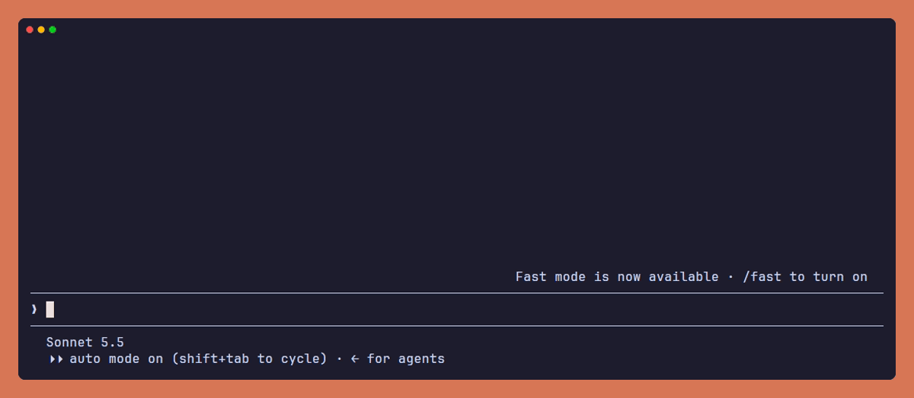

# Claude Toolkit Dev

Faz o plano Pro do Claude Code render mais, sem perder qualidade e sem vazar segredo.

   

**[Instalar](#instalar)** · **[📖 Guia do dia a dia](docs/GUIA.md)** · [Comandos](#comandos) · [Benchmark](bench/README.md)



## Resultados

<picture>
  <source media="(prefers-color-scheme: dark)" srcset="docs/img/custo-dark.svg">
  
</picture>

| −52% | 22/24 | 0/3 |
|:---:|:---:|:---:|
| de custo nas mesmas tarefas | execuções corretas (o Opus de fábrica fez 23/24) | leituras do `.env` (de fábrica: 3/3) |

Medido com o Claude Code real, em HOMEs isoladas e com testes ocultos. O custo é o equivalente em dólar na
API; quanto cada modelo pesa na cota do Pro não é documentado. O que não ajudou ficou de fora.
[Método e números →](bench/README.md)

## Para quem é

- Você usa o plano **Pro** e a cota acaba antes da semana.
- Você quer o mesmo jeito de trabalhar (spec, check, segurança) para o time inteiro.

Não é para você se não quer abrir mão dos seus plugins, MCPs e skills atuais: a instalação remove tudo,
com backup.

## Instalar

Precisa de [Claude Code](https://code.claude.com) com login feito, [Node 22.20+](https://nodejs.org),
[git](https://git-scm.com) e [uv](https://docs.astral.sh/uv/getting-started/installation/). Feche o Claude
Code e rode num terminal comum:

```
npx github:AlfredoNeeto/claude-toolkit#v1.0.2 install
```

> [!WARNING]
> A instalação **remove** plugins, MCPs de usuário, skills, agents, commands e output styles, para o kit
> rodar como foi medido. Antes, faz **backup** em `~/.claude-toolkit/backups/`, e o `restore` volta tudo.
> Histórico, memória e login não são tocados.

<details>
<summary>O que o instalador faz</summary>

1. Confere os pré-requisitos e mostra o que vai remover, pedindo confirmação.
2. Faz backup e remove plugins, MCPs de usuário, skills, agents, commands e output styles.
3. Grava a configuração do kit (`~/.claude/settings.json`, `~/.claude/CLAUDE.md` e a statusline).
4. Instala o OpenSpec, o Playwright CLI, o plugin `toolkit-dev` (na versão da tag que você instalou) e o
   plugin oficial `security-guidance`.
5. Pergunta se você usa Azure DevOps Server. Se não usa, responda `n`.

No Windows, rode no PowerShell ou no Terminal. Com proxy corporativo, defina antes `NODE_EXTRA_CA_CERTS`.

</details>

## Primeiros passos

1. `cd meu-projeto` e `claude`. A statusline no rodapé deve começar por `Sonnet`.
2. `/toolkit-dev:init-project`: descobre a stack e cria `AGENTS.md`, `CLAUDE.md`, `openspec/` e o
   **check** (o build e teste que o Claude roda antes de encerrar). Commite tudo.
3. Peça uma tarefa pequena. Depois, leia o **[Guia do dia a dia](docs/GUIA.md)**.

## Comandos

| No terminal (`npx github:AlfredoNeeto/claude-toolkit#v1.0.2 ...`) | Para quê |
|---|---|
| `install` | Instala ou atualiza o kit |
| `restore [data]` | Volta ao backup mais recente, ou ao de uma data |
| `stats [dias]` | Seu uso por semana (padrão: 28 dias) |
| `secret set\|list\|rm NOME` | [Cofre de variáveis](docs/GUIA.md#tokens-e-senhas-cofre) |
| `ado add URL` | [Azure DevOps Server](docs/GUIA.md#azure-devops-server) |

| No Claude Code | Para quê |
|---|---|
| `/toolkit-dev:init-project` | Prepara ou atualiza o repositório |
| `/toolkit-dev:audit <url>` | Diz se uma skill, plugin, MCP ou repo é seguro **antes** de instalar |
| `/toolkit-dev:convert <arquivo>` | PDF, DOCX, PPTX ou XLSX → Markdown em `docs/` |
| `/toolkit-dev:secret` | Ajuda do cofre |

## O que vem instalado

| | Peça | Para quê |
|:---:|---|---|
| ✅ | Sonnet com esforço medium, subagentes em Sonnet | Metade do custo do Opus |
| ✅ | Bloqueio de `.env`, `secrets/`, chaves, `~/.ssh` e user-secrets do .NET | O Claude não lê segredos |
| ⏳ | Estilo Concise, sugestões de prompt desligadas | Menos tokens por resposta |
| ⏳ | OpenSpec 2.1 | Spec antes do código |
| ⏳ | `security-guidance`, Playwright CLI, MCP context7 | Revisão de segurança, conferir a tela, docs atualizadas |
| ⚙️ | Statusline com modelo, contexto e cota de 5h e 7 dias | Ver a cota antes de acabar |
| ⚙️ | Check obrigatório (até 3 min) | O Claude só encerra com build e teste passando |
| ⚙️ | Cofre de variáveis e guarda de segredos | A IA usa `$NOME` sem ver o valor |
| ⚙️ | MCP Azure DevOps on-prem e DBHub somente leitura | Cards, PRs e banco sem sair do Claude |

✅ ganho medido no [benchmark](bench/README.md) · ⏳ ainda não medido isolado · ⚙️ funcionalidade (o
check e o guarda de segredos não mostraram ganho no benchmark; ficam como proteção no uso real)

## Desinstalar

```
npx github:AlfredoNeeto/claude-toolkit#v1.0.2 restore           # backup mais recente
npx github:AlfredoNeeto/claude-toolkit#v1.0.2 restore <data>    # um específico (lista em ~/.claude-toolkit/backups/)
```

Devolve sua configuração, seus plugins e MCPs, e tira os plugins do kit. Se quiser, apague à mão a pasta
`~/.claude-toolkit/` e rode `npm uninstall -g @fission-ai/openspec @playwright/cli`.

## Privacidade

Sem telemetria. O `stats` lê só as transcrições locais. O context7 recebe suas buscas de documentação, e o
MCP do Azure DevOps fala só com o seu servidor.

## Desenvolvimento

<details>
<summary>Testes, benchmark e como lançar uma versão</summary>

```
npm test                                             # instalador, hooks e ponta a ponta (HOME e binários falsos)
E2E_REAL=1 npm test                                  # + claude real numa HOME isolada (PowerShell: $env:E2E_REAL=1; npm test)
TOOLKIT_MARKETPLACE=/caminho/do/clone node cli.mjs install   # instala a partir do clone local
node bench/run.mjs --dry                             # benchmark: veja bench/README.md
node docs/charts.mjs                                 # regera o gráfico do README
vhs demo/toolkit.tape                                # regera o GIF (terminal comum, com login feito)
```

**Para lançar uma versão:**
1. suba `version` em `package.json` e em `plugins/toolkit-dev/.claude-plugin/plugin.json`, o `"ref"` no
   `init-project` e as tags `#vX.Y.Z` deste README e do `docs/GUIA.md` (um teste confere tudo);
2. commite;
3. crie a tag `vX.Y.Z` e faça o push da `main` e da tag.

</details>

## Licença

[MIT](LICENSE)
