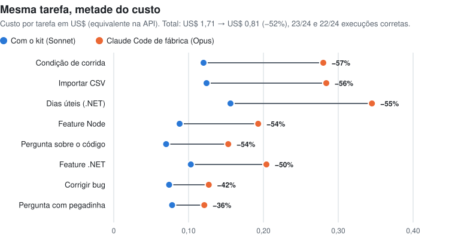

# Claude Code Toolkit (cctk)

Faz a cota do plano Pro do Claude Code durar mais, sem piorar o código e sem deixar a IA ler suas senhas.

Um comando configura o Claude Code do jeito que gastou menos e acertou mais nos nossos testes:

- usa o modelo **Sonnet** no dia a dia, que fez as mesmas tarefas por cerca de metade do custo do Opus;
- **impede o Claude de ler arquivos de senha**, como o `.env`;
- antes de dizer "terminei", o Claude **roda o build e os testes** do projeto;
- mostra no rodapé **quanto da cota você já gastou**.

Projeto da comunidade, sem vínculo com a Anthropic.

[](https://www.npmjs.com/package/@alfredoneeto/cctk)   

**[Instalar](#instalar)** · **[📖 Guia do dia a dia](docs/GUIA.md)** · [Situações](docs/SITUACOES.md) · [Guia de prompts](docs/PROMPTS.md) · [Comandos](#comandos) · [Benchmark](bench/README.md)


## Resultados

<picture>
  <source media="(prefers-color-scheme: dark)" srcset="https://raw.githubusercontent.com/AlfredoNeeto/cctk/main/docs/img/custo-dark.svg">
  
</picture>

| −52% | 22 de 24 | 0 de 3 |
|:---:|:---:|:---:|
| de custo nas mesmas 8 tarefas | tarefas resolvidas certo (o Claude Code de fábrica: 23 de 24) | vezes que o Claude leu o `.env` quando pedimos (de fábrica: 3 de 3) |

**Como medimos:** rodamos o Claude Code de verdade nas mesmas tarefas, com e sem o kit, várias vezes cada, e
conferimos o resultado com testes que o Claude não vê. O custo é o preço que essas execuções teriam na API da
Anthropic. A Anthropic não publica quanto cada modelo gasta da cota do Pro, então esse número serve para comparar,
não para prever a sua cota.

A versão 1.4 acertou 49 de 50 execuções e não deixou vazar nenhum segredo nos testes de segurança. Das 12 mudanças
que testamos no placar para gastar menos ou acertar mais, 3 entraram no kit; o que não ajudou ficou de fora.
[Como medimos e todos os números →](bench/README.md)

## Para quem é

- Você usa o plano **Pro** e a cota acaba antes da semana.
- Você quer que o time todo use o Claude Code do mesmo jeito, com as mesmas travas de segurança.

Não é para você se não quer perder os plugins, MCPs e skills (extensões do Claude Code) que já instalou: a primeira
instalação remove todos, com backup, para o kit funcionar como foi testado.

## Instalar

**Precisa ter:** [Claude Code](https://code.claude.com) com login feito, [Node 22.20+](https://nodejs.org),
[git](https://git-scm.com) e [uv](https://docs.astral.sh/uv/getting-started/installation/). Funciona no
Windows, no macOS e no Linux.

Feche o Claude Code e rode num terminal comum:

```
npm i -g @alfredoneeto/cctk
cctk install
```

Para ver antes o que vai mudar, sem gravar nada: `cctk install --dry-run`. Para atualizar depois: `cctk update`.

> [!WARNING]
> A primeira instalação **remove** plugins, MCPs, skills, agents, commands e output styles que você instalou, para o
> kit funcionar como foi testado. Antes, faz **backup** em `~/.cctk/backups/`, e o `cctk restore` devolve tudo.
> Histórico, memória e login não são tocados. As atualizações não removem nada.

<details>
<summary>O que o instalador faz, passo a passo</summary>

1. Confere se você tem o que precisa (se faltar o uv, oferece instalar) e pede confirmação do que vai remover.
2. Faz o backup e remove plugins, MCPs, skills, agents, commands e output styles.
3. Grava a configuração do kit (`~/.claude/settings.json`, `~/.claude/CLAUDE.md` e o rodapé).
4. Instala as ferramentas do kit (OpenSpec, Playwright CLI, o plugin `cctk` e o plugin oficial `security-guidance`),
   mostrando cada etapa (`[3/8] …`). Se alguma falhar, diz qual e para.
5. Pergunta se você usa Azure DevOps Server. Se não usa, responda `n`.

Numa atualização, os passos 2 e 5 não acontecem: seus plugins, MCPs, permissões e variáveis ficam. No Windows,
rode no PowerShell ou no Terminal. Atrás de proxy corporativo, defina antes `NODE_EXTRA_CA_CERTS`.

</details>

## Primeiros passos

1. Abra o projeto: `cd meu-projeto` e `claude`. O rodapé deve começar por `Sonnet`.
2. No Claude Code, digite `/cctk:init-project`. Ele olha o projeto e cria os arquivos que explicam o projeto ao
   Claude (`AGENTS.md`, `CLAUDE.md`) e o **check**: o comando de build e teste que o Claude roda antes de dizer que
   terminou. Commite esses arquivos.
3. Num terminal, na pasta do projeto, aprove o check: `cctk trust`. O kit só roda esse comando depois que você
   aprova, porque ele vem do repositório e poderia ter sido trocado por alguém.
4. Peça uma tarefa pequena.

Passo a passo completo, com o que conferir em cada etapa: [Primeiro uso](docs/GUIA.md#primeiro-uso).

## Documentação

| Leia | Quando |
|---|---|
| [Primeiro uso](docs/GUIA.md#primeiro-uso) | Acabou de instalar: do `install` ao primeiro pedido, passo a passo |
| [Situações](docs/SITUACOES.md) | Quer uma receita pronta: bug com log, banco, card do Azure DevOps, protótipo, revisão de PR, cota acabando |
| [Guia de prompts](docs/PROMPTS.md) | Quer que o Claude acerte de primeira: como escrever o pedido, modelos prontos e o que fazer quando ele erra |
| [Guia do dia a dia](docs/GUIA.md) | Quer consultar: o rodapé, o check, o cofre de senhas, o Azure DevOps e o que fazer quando dá erro |
| [Glossário](docs/GUIA.md#glossário) | Não entendeu uma palavra: check, spec, MCP, cota, contexto, subagente... |
| [Benchmark](bench/README.md) | Quer saber por que o kit é assim: como medimos, os números e o que ficou de fora |

## Comandos

| No terminal (`cctk ...`) | Para quê |
|---|---|
| `install [--dry-run] [--yes]` | Instala o kit. `--dry-run` só mostra o que mudaria; `--yes` instala sem perguntar |
| `update` | Baixa a versão nova e atualiza, mantendo seus ajustes |
| `doctor` | Confere a instalação e diz o que fazer em cada problema |
| `trust` | Aprova o check do projeto (rode na pasta dele) |
| `restore [data]` | Volta à configuração de antes do kit, ou a um backup de uma data |
| `stats [dias]` | Mostra quanto você usou por semana (padrão: últimos 28 dias) |
| `secret set\|list\|rm NOME` | Guarda um token de desenvolvimento para o Claude usar sem ver o valor ([cofre](docs/GUIA.md#tokens-e-senhas-cofre)) |
| `ado add URL` | Conecta um servidor [Azure DevOps](docs/GUIA.md#azure-devops-server) da sua empresa |

| No Claude Code | Para quê |
|---|---|
| `/cctk:init-project` | Prepara o repositório para o Claude, ou atualiza o que já foi preparado |
| `/cctk:audit <url>` | Diz se uma skill, plugin, MCP ou repositório é seguro **antes** de você instalar |
| `/cctk:convert <arquivo>` | Transforma PDF, Word, PowerPoint ou Excel em texto (Markdown) que o Claude lê melhor |
| `/cctk:prototipo <telas \| print>` | Cria telas clicáveis em HTML para mostrar ao cliente, do zero ou a partir do print de um sistema; depois de aprovado, leva ao código (Angular, React ou Flutter) |
| `/cctk:secret` | Explica como usar o cofre |

## O que vem instalado

| O que faz | Por quê | Medido? |
|---|---|---|
| Usa o **Sonnet** no dia a dia, com esforço médio, também nos subagentes (ajudantes que o Claude abre) | Fez as mesmas tarefas por metade do custo do Opus | Sim |
| **Advisor:** nos pontos difíceis, o Sonnet pode pedir uma segunda opinião ao Opus (recurso experimental do Claude Code) | Acertou mais quando o pedido deixava uma regra sem dizer | Sim |
| Bloqueia a leitura de `.env`, da pasta `secrets/`, de chaves, do `~/.ssh` e dos user-secrets do .NET | O Claude não vê suas senhas | Sim |
| O Claude só edita arquivos dentro do projeto, não faz commit com senha, e no macOS e no Linux roda os comandos isolado do resto do sistema | Um erro da IA estraga menos | Trava de segurança |
| **Check:** antes de encerrar, o Claude roda o build e os testes (até 3 min; você aprova o comando uma vez); em projeto com API, também chama as rotas por HTTP | Ele só diz "pronto" com o projeto passando e o contrato da API inteiro | Trava de qualidade |
| **OpenSpec:** em feature com regra de negócio, o Claude escreve a especificação antes do código e lista o que o pedido não disse | Você corrige a regra antes de virar código | Custa ~5×; veja abaixo |
| **Cofre:** guarda tokens de desenvolvimento criptografados; o Claude usa `$NOME` sem ver o valor | Usar uma API de teste sem expor o token | Funcionalidade |
| Rodapé com o modelo, quanto da conversa está ocupado e quanto da cota de 5 horas e de 7 dias já foi | Ver a cota antes de acabar | Funcionalidade |
| Azure DevOps on-premises e consulta ao banco só para leitura (DBHub) | Ler cards, PRs e dados sem sair do Claude | Funcionalidade |
| Respostas mais curtas e sem sugestão de próximo pedido | Menos texto, menos custo | Ainda não |
| Revisão de segurança automática (`security-guidance`), navegador para conferir a tela (Playwright CLI) e documentação atualizada de bibliotecas (context7) | Achar falha de segurança, ver a tela, não usar API velha | Revisão: sim, roda no Sonnet (~5% a mais por tarefa; achou falha que os testes não pegavam). Os outros: ainda não |

"Sim" é ganho medido no [benchmark](bench/README.md). As travas e o OpenSpec não deixaram o Claude mais barato
nem mais certeiro nos testes; ficam porque protegem no uso real.

## Limitações conhecidas

- **O advisor pode gastar mais cota em conversas longas.** Nos testes, com tarefas curtas, o Sonnet não pediu
  ajuda ao Opus nenhuma vez. Numa conversa longa e difícil ele pode pedir, e cada pedido conta na cota. Nas
  primeiras semanas, acompanhe o `5h` e o `7d` do rodapé. Para desligar, veja as
  [perguntas frequentes](#perguntas-frequentes).
- **O OpenSpec custa cerca de 5 vezes mais que pedir direto.** Nos testes, sem ninguém revisando a especificação,
  ele acertou 24 de 24 contra 22 de 24 pedindo direto, uma diferença que pode ser sorte. Vale quando há regra de
  negócio para você revisar; para tarefa pequena, peça direto ([números](bench/README.md#resultados-19112026)).
- **O kit depende de recursos do Claude Code que mudam entre versões.** Se algo parar depois de atualizar o
  Claude Code, rode `cctk doctor`.
- **No Windows, os comandos que o Claude roda no terminal não ficam isolados.** As travas impedem ler senhas e
  editar fora do projeto, mas não controlam o que ele roda no terminal.

## Desinstalar

```
cctk restore           # volta à configuração de antes do kit
cctk restore <data>    # volta a um backup específico (lista em ~/.cctk/backups/)
```

Devolve sua configuração, seus plugins e MCPs, e tira os plugins do kit. Para apagar tudo: apague a pasta `~/.cctk/`
e rode `npm uninstall -g @alfredoneeto/cctk @fission-ai/openspec @playwright/cli`.

## Perguntas frequentes

**Vou perder meus plugins, MCPs e skills?**
Na primeira instalação, sim, com backup em `~/.cctk/backups/`; o `cctk restore` devolve tudo. As atualizações não
removem nada.

**Posso usar o Opus?**
Sim: abra com `claude --model opus` para planejar uma feature grande. O kit abre no Sonnet porque, nos testes, ele
fez as mesmas tarefas por cerca de metade do custo.

**Como desligo uma peça, como o advisor?**
Apague a linha `"advisorModel"` do `~/.claude/settings.json`. Atenção: o próximo `cctk install` a coloca de volta
([Deu problema?](docs/GUIA.md#deu-problema)).

**O time inteiro precisa instalar?**
Cada pessoa roda `cctk install` uma vez. O `/cctk:init-project` grava no repositório o modelo e a sugestão do plugin,
então quem clona o projeto já recebe o mesmo jeito de trabalhar.

**Funciona no Windows?**
Sim. A diferença é que lá os comandos de terminal não ficam isolados; as travas de senha e de edição valem igual.

**O kit manda dados para algum lugar?**
Não tem telemetria. O `cctk stats` lê só o histórico de conversas no seu computador. O context7 recebe suas buscas
de documentação, e o Azure DevOps fala só com o servidor da sua empresa.

## Problemas e contribuições

Achou um bug ou tem uma sugestão? Abra uma [issue](https://github.com/AlfredoNeeto/cctk/issues) com a
saída do `cctk doctor`. Para desenvolver, rodar os testes ou o benchmark, veja o
[CONTRIBUTING.md](CONTRIBUTING.md). Licença [MIT](LICENSE).
