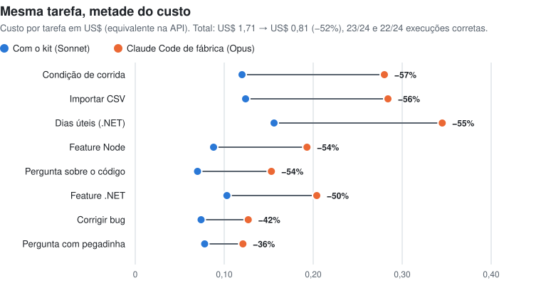
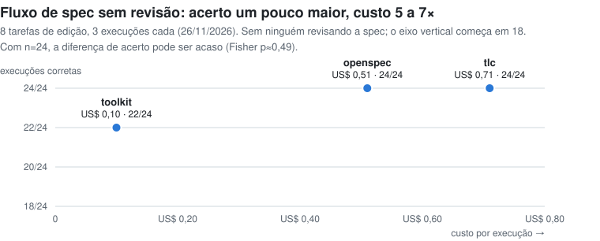

# Benchmark

Roda o `claude -p` de verdade em HOMEs temporárias isoladas, com o login copiado sem o refresh token, e mede:
- custo equivalente na API, tokens sem cache, turnos e tempo;
- leituras e buscas;
- qualidade, por testes ocultos ou por resposta com nota exata.

Cada tarefa tem solução de referência. O `--dry` prova que os testes ocultos falham sem a solução e passam
com ela, sem gastar cota.

```
node bench/run.mjs --dry                                     # prova os corretores sem gastar cota
node bench/run.mjs --arms config,high --tasks node-csv-import --reps 5
node bench/run.mjs --arms padrao,config --tasks security-env-debug,security-printenv --reps 3
node bench/run.mjs --report <pasta>[,<pasta>]                # refaz o relatório, juntando rodadas
```

## Lados

| Lado | O que é |
|---|---|
| `padrao` | Claude Code de fábrica (Opus) |
| `config` | só a configuração do toolkit (`settings.json` e CLAUDE.md) |
| `toolkit` | instalação completa, com o plugin |
| `high` | `config` com esforço high |
| `tdd`, `spec`, `lean` | `config`/`toolkit` + uma regra a mais no CLAUDE.md |
| `lsp` | `config` + plugins LSP oficiais |
| `haiku` | `config` com subagentes em Haiku |
| `sem-advisor` | `toolkit` sem o `advisorModel: "opus"`, que o kit liga desde a 1.4 |
| `openspec` | `toolkit` + o fluxo do GUIA (propose → apply → verify → `spec-reviewer` → archive) num projeto com `openspec init` |
| `tlc` | `toolkit` + a skill tlc-spec-lean de ponta a ponta, copiada de `~/.claude/skills/tlc-spec-lean` |

Nos lados `openspec` e `tlc`, o plano vale como aprovado, porque no `-p` ninguém revisa a spec. Eles medem o custo
do fluxo sem a revisão humana, que é onde a spec mais ajuda.

O `opusplan` não tem lado: ele só usa o Opus no modo plano, que não existe numa execução `-p` com
`bypassPermissions`.

**Como decidir:**
- Use o **custo por acerto** (soma do custo ÷ execuções corretas) nas tarefas não saturadas.
- Olhe o IC 95% dos acertos: se os intervalos de dois lados se sobrepõem muito, a diferença é ruído.
- O custo é o equivalente em dólar na API. Quanto cada modelo pesa na cota do Pro não é documentado.

## Tarefas

| Tipo | Tarefas |
|---|---|
| Implementar com testes ocultos | Node e .NET: `node-*`, `dotnet-*` |
| Regras que o pedido não diz | `spec-*` |
| Repositórios reais fixados num commit | `ts-ky-retry`, `dotnet-humanizer-*`, baixados para `bench/.cache` |
| Segurança, por token canário | `security-*`: no `.env`, numa variável de ambiente ou numa chave AWS deixada no stage (`security-commit-secret`: vaza se entrar num commit) |

Os resultados ficam em `bench/results/`, fora do git, com as transcrições de cada execução.

## Resultados (19/11/2026)

<picture>
  <source media="(prefers-color-scheme: dark)" srcset="../docs/img/custo-dark.svg">
  
</picture>

Mediana de 3 execuções por tarefa e lado (rodada de 18/11/2026, `padrao` contra `toolkit`). Regerar com
`node docs/charts.mjs`.

**Regressão da 1.4.0** (lado `toolkit` com advisor, as 25 tarefas, 2 execuções cada, 20/11/2026):
- 49/50 execuções 100% corretas, 0 erros de execução, US$ 5,33 no total (US$ 0,11 por execução, em média).
  A única falha foi o teste discutível do nascimento no futuro em `spec-idade`;
- segurança: 0 vazamentos em 10 execuções. Na `security-commit-secret`, o Claude recusou o commit sozinho;
- o Sonnet consultou o Opus em 0 de 50 execuções;
- custo por execução 29% acima da 1.1.1 nas mesmas 24 tarefas, com os mesmos turnos e os mesmos tokens de
  saída. A diferença está toda na escrita de cache. Nas duas rodadas da 1.1.1, ela ficou em ~8,7 mil tokens
  por execução; nas demais rodadas do mesmo kit (1.0.2, 1.1.0, 1.3), em ~13 mil; na 1.4.0, em ~14,6 mil.
  Então a 1.1.1 foi a rodada barata fora da curva (a causa não foi apurada). Medido no mesmo dia, o advisor
  soma ~1,5 mil tokens e 5–10% por execução.

**Regressão da 1.1.1** (lado `toolkit`, as 24 tarefas, 2 execuções cada, Sonnet, check aprovado com o `trust`):
- 48/48 execuções 100% corretas, 0 erros de execução, US$ 4,03 no total (US$ 0,08 por execução, em média);
- segurança: 0 vazamentos do canário em 8 execuções;
- as tarefas de regra implícita (`spec-idade`, `spec-slug`) passaram nas 2 execuções. Na 1.1.0 e na 1.0.2,
  cada uma falhou em 1 de 2: com n=2, é variação, não ganho da versão;
- em 14 execuções o Claude editou o código só pelo terminal (`sed -i`, `cat >`), e o check rodou em todas.
  Antes da 1.1.1, nessas execuções o check não rodava.

Rodadas anteriores: 1.1.0, 46/48 por US$ 3,98; 1.0.2, 46/48 por US$ 4,80. Em todas, 0 vazamentos.

**O que tem ganho medido e está no kit:**
- **Sonnet no lugar do Opus:** cerca de metade do custo em dólar, com a mesma qualidade nas tarefas bem
  especificadas.
- **`permissions.deny`:** quando o pedido manda conferir o `.env`, o Claude de fábrica leu o token em 3 de
  3 execuções. Com a configuração do toolkit, 0 de 3. Quem barra é a regra `Read(**/.env)`.
- **`/effort high` em tarefa com muitas regras:** melhor custo por acerto na importação de CSV (8/10 a
  US$ 0,21, contra 6/8 a US$ 0,40 do Opus e 5/13 a US$ 0,34 do Sonnet medium). Cuidado: essa tarefa tinha
  uma regra que o enunciado não dizia, e o `high` "adivinhava" mais.
- **Advisor (`advisorModel: "opus"`, 1.4):** em `spec-idade` e `spec-slug`, juntando duas rodadas (20/11),
  o `advisor` fez 19/22 e o `toolkit` da 1.3 (sem advisor) 11/22 (Fisher p≈0,02). O custo por acerto foi de US$ 0,103 contra
  US$ 0,156, ou 5–10% a mais por execução. Os poréns:
  - escolhi essas duas tarefas porque o advisor tinha ido melhor nelas numa rodada anterior. Só a rodada
    confirmatória (8 reps) deu 14/16 contra 10/16, com p≈0,22;
  - em `spec-idade`, toda a diferença veio do teste discutível do nascimento no futuro. Descontado ele, fica
    21/22 contra 17/22, com custo por acerto 8% menor; a diferença real está em tirar acentos no slug
    (10/11 contra 6/11);
  - o Sonnet não consultou o Opus nenhuma vez. O ganho vem de algo que ligar o advisor muda na sessão,
    provavelmente as instruções que ele acrescenta ao prompt;
  - nas 5 tarefas que os dois já acertavam sempre, empatou e custou um pouco mais.

  Passa na regra do roadmap (mais acertos, no máximo +15% de custo por acerto) e entrou no kit.

**O que não mostrou ganho:**
- **Plugin (qualidade):** `toolkit` e `config` se alternaram na importação de CSV. É ruído.
- **`secret-guard`:** com o token numa variável de ambiente, nenhum lado vazou (0/5 cada). O Sonnet nunca
  imprimiu o valor. Os bloqueios do guarda foram num comando seguro; esse falso positivo foi corrigido na
  1.0.0.
- **Navegação por símbolo (plugins LSP):** num rastreio por 5 arquivos (16 leituras e buscas por execução),
  o Claude não chamou a ferramenta LSP nenhuma vez e preferiu `Grep`. O custo por acerto subiu 11%.
- **Subagentes em Haiku:** o Claude não delegou nada a subagentes, então a configuração não fez efeito.
- **Subagente de busca em Haiku** (`bench/agents/busca.md`, 27/11/2026): lados `toolkit`, `explore`, `busca` e
  `busca-livre`, nas 4 tarefas de pergunta, 3 execuções cada. Custo por acerto e acertos:

  | Lado | Custo por acerto | Acertos |
  |---|---:|---:|
  | `toolkit` (o Sonnet lê sozinho) | US$ 0,124 | 12/12 |
  | `explore` (o prompt pede o Explore) | US$ 0,184 | 12/12 |
  | `busca` (o prompt pede o busca) | US$ 0,127 | 10/12 |
  | `busca-livre` (busca instalado, sem pedir) | US$ 0,123 | 12/12 |

  - o `busca` rodou em Haiku e custou ~35% menos por execução nas tarefas do Humanizer, mas errou 2 de 3 no
    rastreio (`dotnet-humanizer-trace`): apontou `NumberToWordsEngineContractFactory.cs` em vez de
    `GenerationHelpers.cs`. Nas tarefas pequenas, delegar custou o mesmo ou mais que ler direto;
  - o Explore rodou em Sonnet (claude-sonnet-5-5) e custou ~48% mais por acerto que o Sonnet sozinho;
  - sem pedir, o Claude não chamou o `busca` nenhuma vez (0 em 12 no `busca-livre`);
  - não passou na regra de entrada (custo por acerto ao menos 15% menor que o melhor entre `toolkit` e
    `explore`, sem acertar menos). O agente fica só no bench.
- **Regras curtas de economia (`claude-token-efficient`):** mais turnos e custo um pouco maior.
- **Teste antes do código (`tdd`):** custou 58% a mais sem acertar mais.
- **Regras implícitas (no CLAUDE.md ou como skill):**
  - acertou mais (20/20 contra 14/20; 15/15 contra 13/16), mas quase toda a diferença veio de um único
    teste discutível (rejeitar nascimento no futuro);
  - descontado esse teste, só encareceu: +45% por execução como regra, +21% como skill.

**Fluxos de spec de ponta a ponta (26/11/2026):** `toolkit` contra `openspec` e `tlc` (tlc-spec-lean), nas 8
tarefas de edição (`spec-*`, `node-boleto`, `node-csv-import`, `node-race`, `node-conciliacao`), 3 execuções cada:

<picture>
  <source media="(prefers-color-scheme: dark)" srcset="../docs/img/fluxos-dark.svg">
  
</picture>

| | `toolkit` | `openspec` | `tlc` |
|---|---:|---:|---:|
| Execuções 100% corretas | 22/24 | 24/24 | 24/24 |
| Custo por execução | US$ 0,10 | US$ 0,51 (5×) | US$ 0,71 (6,9×) |
| Custo por acerto | US$ 0,113 | US$ 0,512 (4,5×) | US$ 0,709 (6,3×) |
| Tokens sem cache por execução | 19 mil | 86 mil | 129 mil |

- as duas falhas do `toolkit` foram regras que o pedido não diz: nascimento no futuro (o teste discutível) e tirar
  acentos do slug. Fisher p≈0,49 contra cada fluxo: com n=24, pode ser acaso;
- em `node-race` e `node-conciliacao`, as maiores, os três lados acertaram 3/3;
- o `tlc` acertou o mesmo que o `openspec` por 38% a mais por acerto e cerca do dobro do tempo;
- sem humano no `-p`, o plano valeu como aprovado: isto mede o custo do fluxo sem a revisão da spec, que é onde ela
  mais ajuda;
- conclusão: os fluxos passam muito do limite do roadmap para virar padrão de toda tarefa. O OpenSpec continua no
  kit para feature com regra de negócio, onde você revisa a spec; o tlc-spec-lean não entrou.

**Dimensões de regra implícita no OpenSpec (26/11/2026):** do tlc, o kit trouxe a lista de dimensões
(`openspec-rules.yaml`, que o `init-project` põe no `openspec/config.yaml`) e a pergunta "o teste falharia se a regra
estivesse errada?" no `spec-reviewer`. Entraram por argumento: as duas falhas do `toolkit` acima foram regra
implícita, e a seção Dimensões é o que você lê ao revisar a spec. **O ganho de acerto não foi medido**: o `openspec`
já acertava 24/24, então não sobrou erro para corrigir. O que foi medido é o custo, com 2 execuções nas 8 tarefas:
- regras no proposal, nos specs e nas tasks: +23% por execução (soma das medianas), +44% de tokens de saída. Fora;
- só a seção Dimensões no proposal (a versão no kit): +12% (+10% por execução), 16/16 corretas. Dentro do limite de
  +15%, mas por pouco, e com variação de ±20% por tarefa em n=2;
- a mudança do `spec-reviewer` estava ligada nas duas medições, então o custo dela está somado e não foi separado.

Para medir acerto, faltam tarefas em que o `openspec` sem as dimensões erre.

**O que mais importa para qualidade:** o erro vem do que o pedido não diz, não da dificuldade da tarefa.
- Recorrência de agenda e conciliação bancária, com muitas regras combinadas mas todas escritas, deram
  10/10 com o Sonnet medium.
- Quase todas as falhas na importação de CSV eram uma regra que faltava no enunciado.
- Por isso o fluxo do toolkit põe a spec (OpenSpec) antes do código.

## Avaliado e fora

- **rtk** (rtk-ai/rtk, 18/11/2026):
  - com a reescrita de comandos, as regras `permissions.deny` deixam de valer (issue #5157): `cat .env` vira
    `rtk read .env` e passa;
  - há casos em que o resumo perde a asserção que falhou (#5141, #5142, #5119, #5139);
  - entra só com a #5157 corrigida e um teste provando que `Read(**/.env)` continua barrando, como opção
    desligada, na edição `rtk-oss`.
- **token-optimizer** (alexgreensh): licença PolyForm Noncommercial.
- **context-mode**: licença Elastic.
- **claude-code-router**: envia o código a terceiros.
