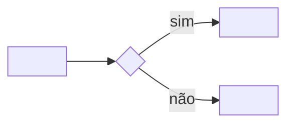

<!--
Modelo de especificação do /cctk:prototipo. Comentários como este não saem no PDF.
Regras de escrita:
- Núcleo (seções sem "opcional") entra sempre. Opcional só entra se o usuário pediu ou se o protótipo já tem o conteúdo.
- Escreva só o que o protótipo e a conversa sustentam. O que ninguém decidiu vai para "Questões em aberto", nunca é inventado.
- Um requisito por linha, verificável: "O sistema deve...", "QUANDO <evento>, o sistema deve...", "SE <condição>, ENTÃO o sistema deve...".
  Nada de "rápido", "fácil", "amigável": troque por número ou comportamento que dá para testar.
- IDs estáveis (RF-01, RN-01, RNF-01, MSG-01, CT-01, Q-01). Nunca reaproveite um ID removido.
- Separe requisito (o que o sistema faz) de regra de negócio (política que vale com ou sem sistema).
- Cada número de tela (círculo laranja) vira um item da legenda que cita os IDs que ele mostra.
- Dados fictícios. Nada de dado real de cliente: o documento vai para fora.
Apague os blocos opcionais que não usar e renumere as seções.
-->

# Especificação – <nome da funcionalidade ou sistema>

<Uma frase dizendo o que esta entrega resolve.>

| Item | Valor |
|---|---|
| Sistema | <sistema / módulo> |
| Cliente / área | <quem pediu> |
| Versão | 1.0 |
| Data | <dd/mm/aaaa> |
| Situação | Rascunho · Em revisão · Aprovada |
| Responsável | <quem escreveu> |

## Histórico de versões

| Versão | Data | O que mudou |
|---|---|---|
| 1.0 | <dd/mm/aaaa> | Primeira versão, com protótipo de <n> telas. |

## 1. Objetivo e contexto

<Como é hoje, qual o problema, quem sofre com ele. Depois: o que muda com esta entrega.>

**Resultado esperado:** <o que o cliente percebe quando estiver pronto, em uma ou duas frases.>

## 2. Escopo

### 2.1 Dentro do escopo

- <item>

### 2.2 Fora do escopo

<!-- Tão importante quanto o que entra: corta expectativa e retrabalho. -->

- <item>

## 3. Perfis de usuário

| Perfil | Quem é | O que faz nesta funcionalidade |
|---|---|---|
| <perfil> | <descrição> | <ações> |

## 4. Glossário

| Termo | Significado |
|---|---|
| <termo> | <definição curta, no sentido usado aqui> |

<!-- OPCIONAL: visão geral do fluxo. Use quando há mais de 3 passos ou decisões. -->

## 5. Visão geral do fluxo



## 6. Requisitos funcionais

| ID | Requisito | Prioridade | Critério de aceite |
|---|---|---|---|
| RF-01 | O sistema deve <comportamento>. | Obrigatório · Desejável · Futuro | <como saber que está pronto> |

## 7. Regras de negócio

| ID | Regra |
|---|---|
| RN-01 | <política, cálculo, restrição ou validação. Diga o que acontece quando a regra impede a ação.> |

<!-- OPCIONAL: estados de campo ou de tela. Use quando um campo muda de visível/obrigatório/valor conforme a situação. -->

## 8. Estados

| Situação | Campo / área | Visível | Obrigatório | O que acontece |
|---|---|---|---|---|
| <situação> | <campo> | Sim · Não | Sim · Não | <comportamento> |

<!-- OPCIONAL: catálogo de mensagens. Recomendado sempre que há validação ou bloqueio: texto final, igual ao do sistema. -->

## 9. Mensagens

| ID | Tipo | Quando aparece | Texto |
|---|---|---|---|
| MSG-01 | Erro · Atenção · Informação · Sucesso | RN-01 | <texto exato> |

## 10. Telas

<!--
Uma subseção por tela, na ordem do fluxo. Imagem gerada por: render.mjs prints <pasta> --anotar
Estados importantes (vazio, erro, modal aberto) entram como telas próprias: prints <pasta> --anotar painel.html#vazio
-->

As telas são do protótipo navegável, com dados fictícios. Os números em laranja correspondem à legenda abaixo de cada tela.

### 10.1 <Nome da tela>

<Onde fica (menu > submenu) e para que serve, em uma frase.>


1. <O que o elemento faz e o que acontece ao interagir.> (RF-01, RN-01)
2. <...> (MSG-01)

## 11. Requisitos não funcionais

| ID | Categoria | Requisito |
|---|---|---|
| RNF-01 | Desempenho · Segurança · Acessibilidade · Compatibilidade · Auditoria | <mensurável: "lista carrega em até 2 s com 10 mil registros"> |

<!-- OPCIONAL: permissões. Use quando perfis diferentes veem ou fazem coisas diferentes. -->

## 12. Permissões

| Ação | <perfil 1> | <perfil 2> |
|---|---|---|
| <ação> | Sim | Não |

<!-- OPCIONAL: integrações. Use quando a entrega lê ou grava em outro sistema, API, arquivo ou fila. -->

## 13. Integrações

| Sistema | Direção | O que trafega | Quando |
|---|---|---|---|
| <sistema> | Envia · Recebe | <dados> | <evento> |

<!-- OPCIONAL: dados. Entidades e campos novos, em linguagem de negócio. Script e consulta ficam para a implementação. -->

## 14. Dados

| Entidade | Campo | Tipo | Obrigatório | Observação |
|---|---|---|---|---|
| <entidade> | <campo> | <texto · número · data · sim/não> | Sim · Não | <regra> |

<!-- OPCIONAL: cenários de teste. Recomendado quando o documento será usado para homologação. -->

## 15. Cenários de teste

| ID | Cenário | Passos | Resultado esperado | Cobre |
|---|---|---|---|---|
| CT-01 | <cenário> | <passos> | <resultado> | RF-01, RN-01 |

```gherkin
Funcionalidade: <nome>
  Cenário: <cenário principal>
    Dado <contexto>
    Quando <ação>
    Então <resultado verificável>
```

<!-- OPCIONAL: rastreabilidade. Use quando há mais de ~8 requisitos ou regras. -->

## 16. Rastreabilidade

| Requisito / regra | Telas | Cenários |
|---|---|---|
| RF-01 | 10.1 | CT-01 |

<!-- OPCIONAL: riscos. -->

## 17. Riscos

| Risco | Impacto | O que fazer |
|---|---|---|
| <risco> | Alto · Médio · Baixo | <mitigação> |

## 18. Premissas e restrições

| # | Premissa ou restrição | Se não se confirmar |
|---|---|---|
| P-01 | <o que estamos assumindo> | <o que muda> |

## 19. Questões em aberto

<!-- Tudo que o protótipo não decide. Melhor uma pergunta aqui do que uma regra inventada. -->

| # | Pergunta | Quem responde | Impacto se ficar aberta |
|---|---|---|---|
| Q-01 | <pergunta> | <pessoa/área> | <o que trava> |

<!-- OPCIONAL: implementação com agente de código. Use quando o próximo passo é desenvolver com o Claude Code. -->

## 20. Para implementar

Siga com o OpenSpec citando este arquivo: `/openspec-propose <ideia> @<caminho>/especificacao.md`. Cada RF e RN vira requisito da change, os cenários da seção 15 viram os cenários da spec, e a seção 19 precisa estar vazia ou com as respostas antes de implementar.

<!-- OPCIONAL: aprovação. Use quando o cliente assina o aceite. -->

## 21. Aprovação

| Nome | Papel | Data | Assinatura |
|---|---|---|---|
| | | | |
